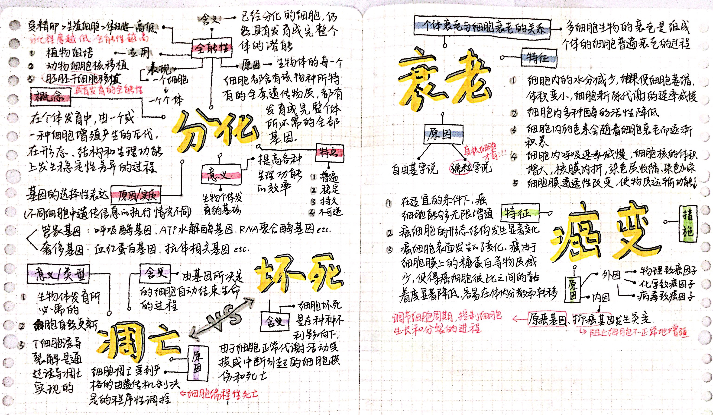
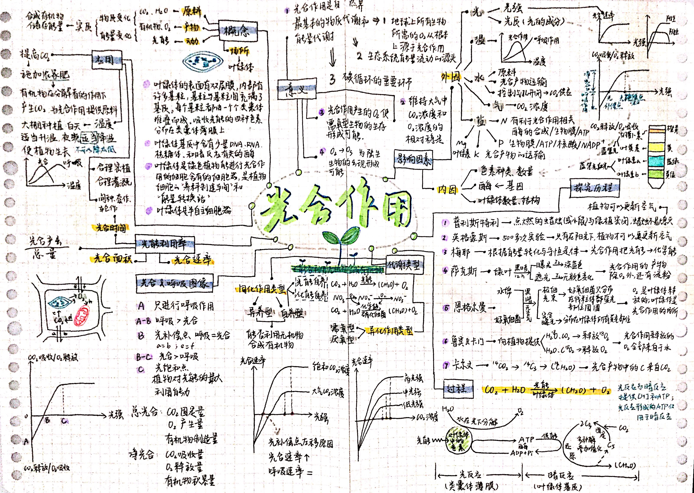
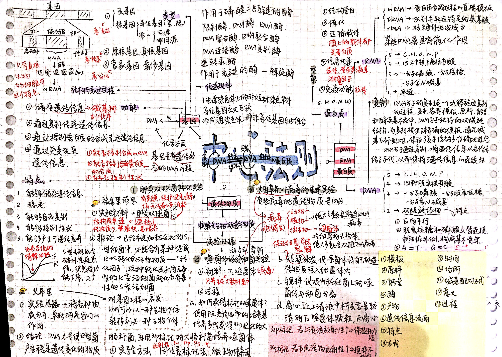
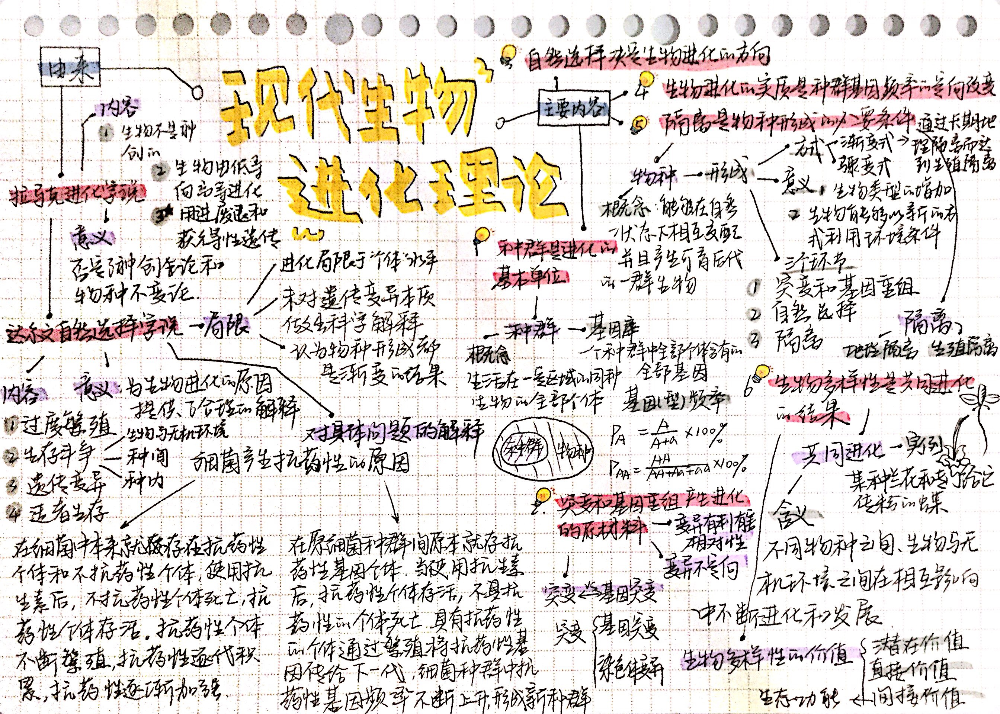
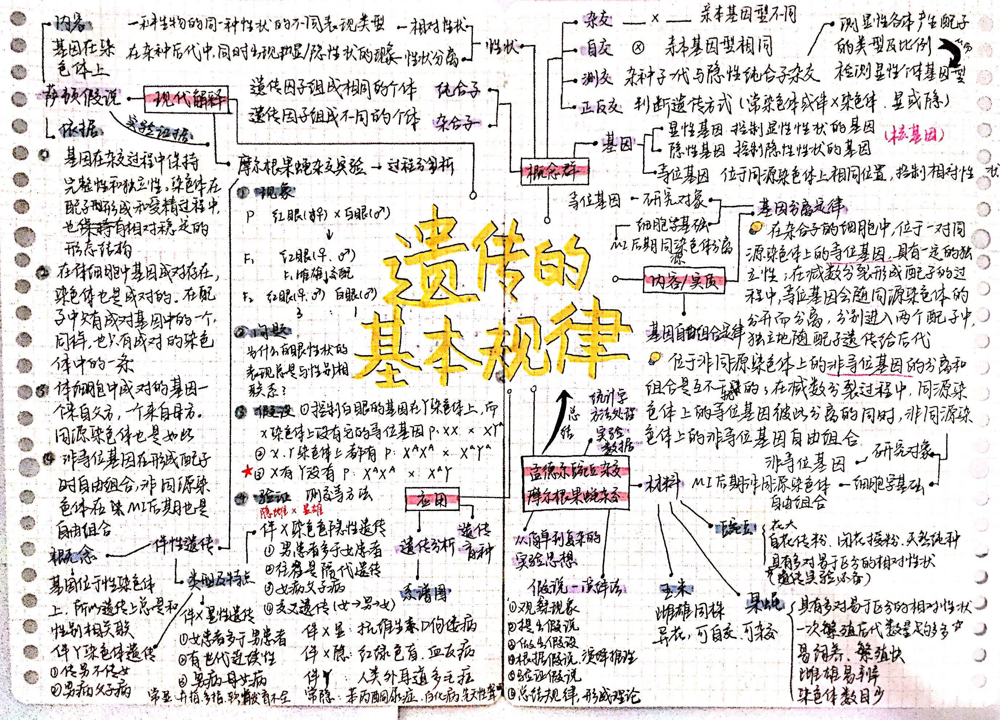
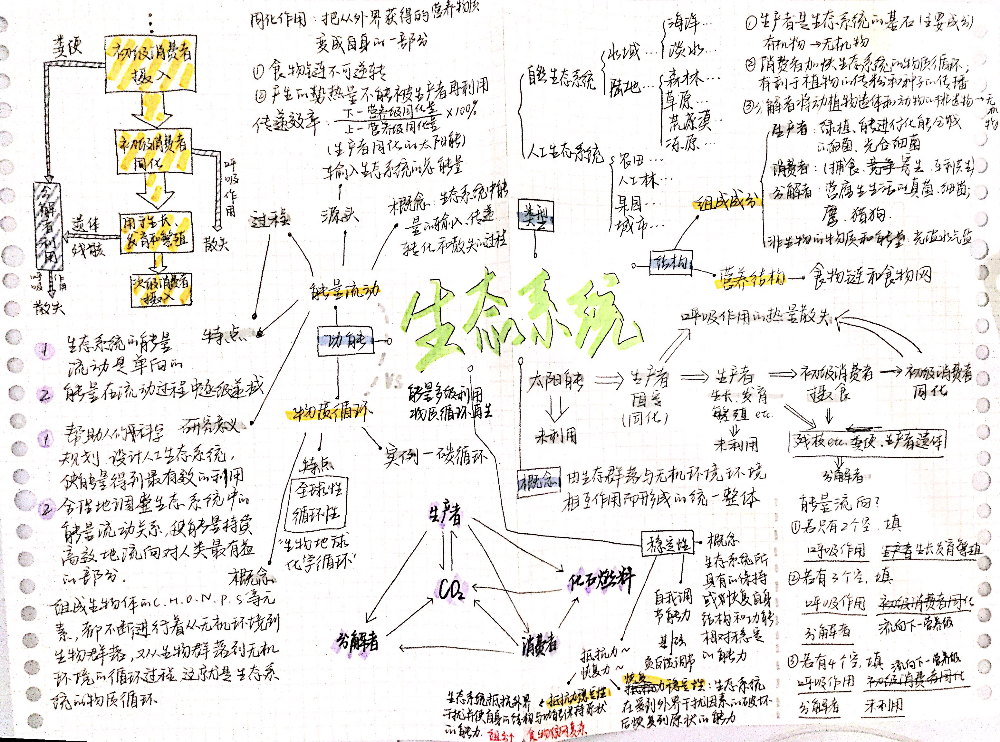

这是我备战**高考**时整理的高中生物笔记，汇总了重要概念、图表和解题思路，方便考前集中复习。

[**下载生物知识要点（PDF）**](/notes/high-school-biology/pdf/biology-golden-nuggets.pdf)

我还把细胞生物学、遗传、进化和生态等内容整理成了思维导图，希望通过梳理知识之间的联系，让复杂的内容更容易理解和记忆。

#### 思维导图

