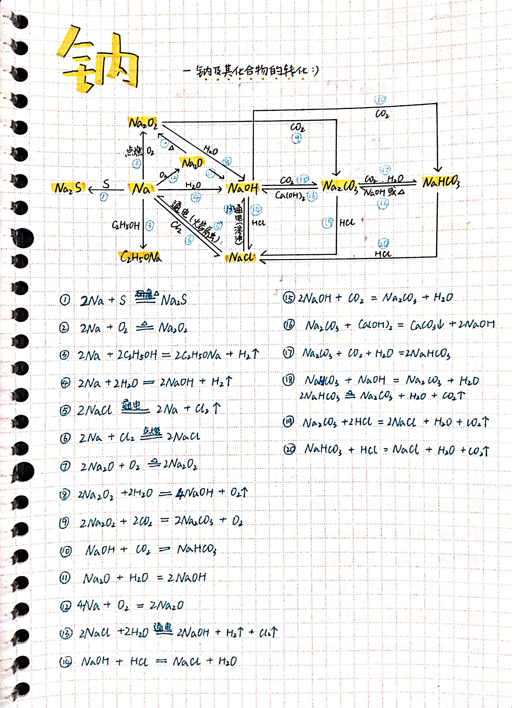
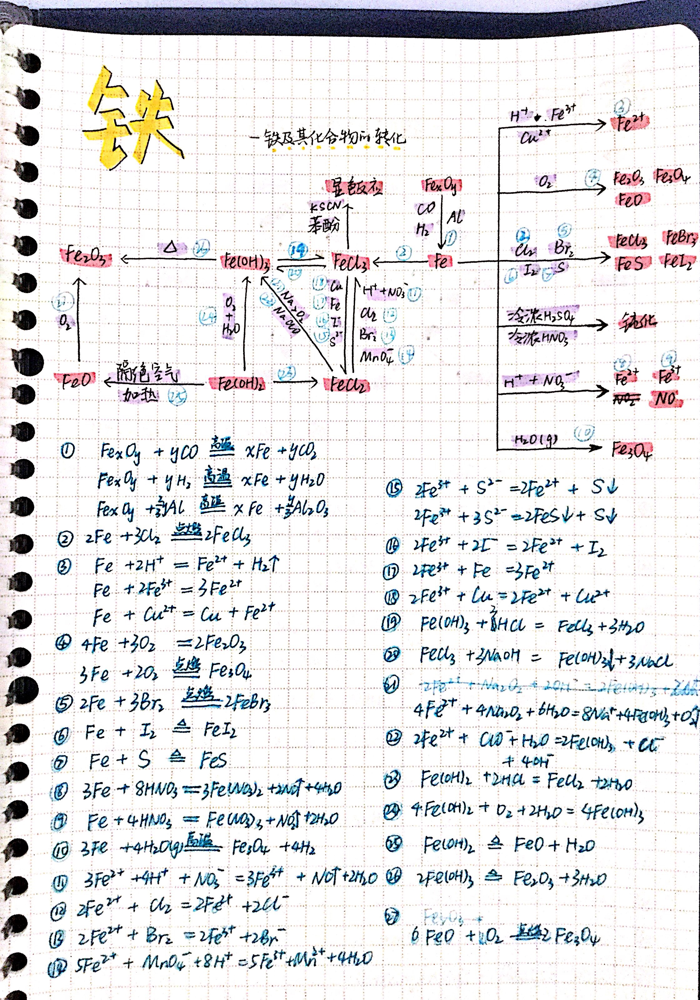
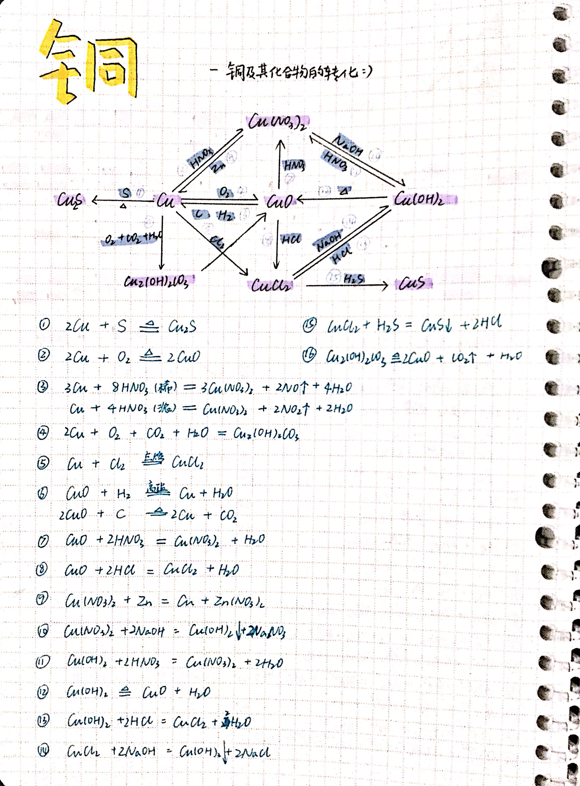
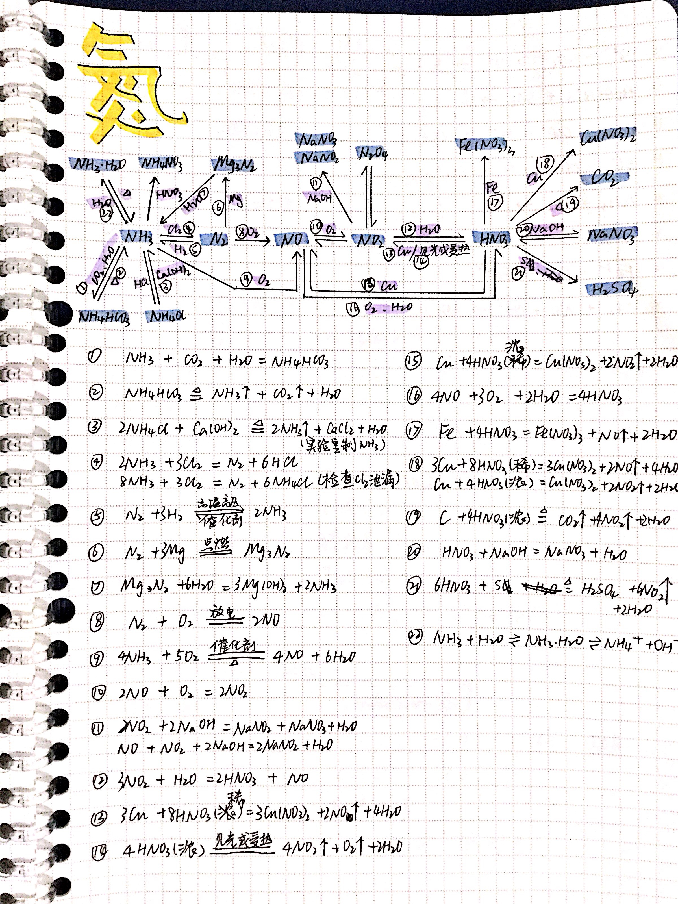
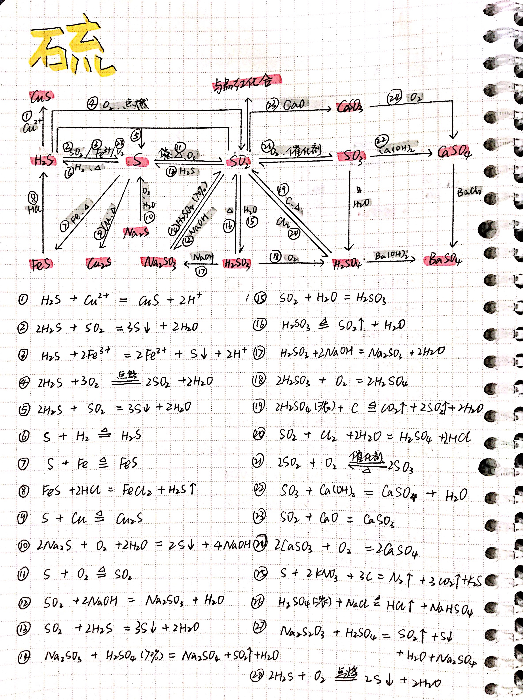

这是我的高中化学笔记，主体分为完整课程笔记和考前复习提纲两部分，另附物质结构推理题的整理。特别感谢同学**李坤鹏**提供自己的课堂笔记供我参考。

- [**完整课程笔记（PDF）**](/notes/high-school-chemistry/pdf/chemistry.pdf)：详细梳理高中化学的课程内容。
- [**考前复习提纲（PDF）**](/notes/high-school-chemistry/pdf/chemistry-review.pdf)：提炼重点知识，方便考前快速回顾。
- [**物质结构推理（PDF）**](/notes/high-school-chemistry/pdf/reasoning.pdf)：整理物质结构推理题的解题思路。

#### 常见元素的化学方程式

下面几张图汇总了常见元素的重要化学反应。

